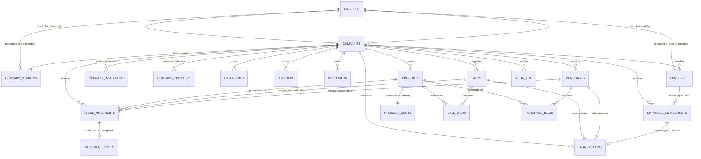

# Especificación Técnica y Funcional: Stock App
**Tipo de Documento:** Especificación de Requerimientos y Arquitectura de Software  
**Fase del Proyecto:** Fase 1 — Especificación y Planificación  
**Versión:** 2.0 (SaaS Multiempresa Compartido — Modelo Pooled, Claves Compuestas, Contadores por Empresa y Gobernanza de Membresías)  
**Fecha:** Octubre 2026  

> [!IMPORTANT]
> **Estructura Modular de la Especificación:**  
> Este documento consolidado actúa como referencia ejecutiva integral. La especificación técnica completa y desglosada con su código SQL exacto se encuentra dividida en los siguientes archivos modulares dentro de `docs/spec/`:
> 1. [01-arquitectura.md](file:///c:/Users/herna/Desktop/Stockly/docs/spec/01-arquitectura.md): Arquitectura SaaS Multiempresa Compartida (Pooled), Límites de Confianza, Identidad Global, Titularidad (`owner_id` vs `created_by`) y Ciclo de Vida del Tenant.
> 2. [02-modelo-datos.md](file:///c:/Users/herna/Desktop/Stockly/docs/spec/02-modelo-datos.md): Esquema Relacional Multiempresa, Claves Foráneas Compuestas, Semántica `MATCH SIMPLE`, `company_counters`, Inmutabilidad e Índices.
> 3. [03-funciones.md](file:///c:/Users/herna/Desktop/Stockly/docs/spec/03-funciones.md): Lógica de Servidor, Procedimientos Almacenados, Gobernanza de Membresías y Funciones Atómicas PL/pgSQL Aisladas por Tenant.
> 4. [04-seguridad-rls.md](file:///c:/Users/herna/Desktop/Stockly/docs/spec/04-seguridad-rls.md): Políticas RLS, Esquema Privado de Autorización (`private`), Salvaguarda del Último Admin por Empresa, Storage y Realtime.
> 5. [05-tests-y-tandas.md](file:///c:/Users/herna/Desktop/Stockly/docs/spec/05-tests-y-tandas.md): Estrategia de Tests de Base de Datos y Plan de Ejecución de la Fase 2 en 5 Tandas (2.0 a 2.4).

---

## 1. Resumen Ejecutivo y Objetivos

El presente documento define la arquitectura, el modelo relacional, las funciones transaccionales seguras, las políticas de seguridad (RLS), la auditoría universal y el mapa de pantallas para la aplicación **Stockly**, diseñada como un SaaS multiempresa compartido (pooled database) para empresas de gestión comercial e inventario.

### Principios Rectores
1. **Online-First y Única Fuente de Verdad:** Supabase (PostgreSQL 15+, Auth, RLS, Realtime) centraliza todos los datos sin almacenamiento local SQLite. Si se interrumpe la conexión, la aplicación bloquea acciones de mutación y alerta al usuario mediante banners de desconexión.
2. **Cero Errores y Tipado Estricto:** TypeScript estricto (`strict: true`) y validación en tiempo de ejecución con esquemas Zod en todas las entradas y salidas de datos. Prohibido el uso de `any` y `@ts-ignore`.
3. **Consistencia Visual con Tema Oscuro:** Adherencia estricta a `diseno-stock-app` (tokens `--bg: #060A13`, `--surface: #0B1220`, `--primary: #2F6BFF`, tipografía serif en títulos y sans en cuerpo con `tabular-nums` en cifras numéricas). Moneda y fechas adaptadas a la configuración de cada empresa.
4. **SaaS Multiempresa Compartido (Modelo Pooled):** Todas las empresas coexisten en una única instancia de base de datos compartida. El aislamiento es estricto y gobernado en el motor relacional mediante:
   - Columna `company_id UUID NOT NULL REFERENCES companies(id)` en todas las tablas del dominio.
   - Claves foráneas compuestas obligatorias `(company_id, foreign_id)` para impedir referencias cruzadas entre empresas.
   - Políticas RLS basadas en membresías activas (`private.my_active_company_ids()`).
5. **Identidad Global Desacoplada de Tenants:** La tabla `profiles` representa únicamente la identidad global del usuario (`id, email, full_name`). No almacena roles ni flags de activación (`role`, `is_active`, `employee_id` quedan eliminados). La pertenencia, roles y estado residen exclusivamente en `company_members`.
6. **Gobernanza y Jerarquía de Membresías:**
   - La titularidad vigente reside en `companies.owner_id` (referenciando `profiles(id)`), mientras `companies.created_by` preserva la auditoría histórica inmutable.
   - Solo el titular vigente (`owner_id`) puede invitar o promover usuarios con rol `master_admin`. Un `master_admin` común únicamente administra empleados.
   - Las membresías revocadas no se reactivan mediante nuevas invitaciones; requieren una acción administrativa explícita (`reactivate_member`) con motivo auditado.
   - El traspaso de titularidad se realiza de forma atómica mediante `transfer_company_ownership`.
7. **Numeración Comercial Transaccional por Empresa:** Se eliminan las secuencias globales de PostgreSQL (`sale_number_seq`, `purchase_number_seq`). La correlatividad se gobierna por empresa en la tabla `company_counters` con bloqueo pesimista transaccional (`FOR UPDATE`), revirtiéndose automáticamente ante fallos transaccionales (`ROLLBACK`).
8. **Operaciones Estrictamente al Contado:** Todas las ventas y compras se liquidan en el acto (efectivo, transferencia bancaria inmediata, tarjeta de débito/crédito, cheque entregado/cobrado). No contempla cuentas corrientes de clientes (fiados) ni cuentas por pagar a proveedores en esta fase.
9. **Comprobantes Internos:** El sistema emite notas de venta, remitos y tickets de control interno de la empresa. **No es un facturador fiscal electrónico ni se conecta con los Web Services de ARCA (ex-AFIP)**. Si se informa el CUIT de una empresa, se valida su formato y dígito verificador mediante algoritmo Módulo 11 (AFIP), siendo opcional y sin unicidad global obligatoria.
10. **Stock Negativo Autorizado y Valuación Congelada:** Las operaciones autorizadas permiten descargas con stock insuficiente (`current_stock < 0`), señalizándose con badges `--danger` en la interfaz. La valuación de salida se congela de forma inmutable al último costo de reposición conocido (`product_costs.cost_price`).
11. **Inmutabilidad y Anulación Controlada:** Las tablas transaccionales (`sales`, `purchases`, `employee_settlements`) solo admiten la transición `completed/confirmed -> cancelled` mediante funciones autorizadas que asientan `cancelled_at`, `cancelled_by` y `cancel_reason`. Los borradores de liquidaciones se gestionan exclusivamente mediante RPCs. `stock_movements`, `sale_items`, `purchase_items`, `movement_costs` y `audit_log` son 100% inmutables.
12. **Baja Lógica de Empresas:** La desactivación de empresas (`companies.is_active = false`) bloquea de forma absoluta todas las mutaciones en el tenant. El titular y los administradores vigentes conservan acceso de solo lectura para auditoría legal y reportes; los empleados pierden acceso operativo.

---

## 2. Arquitectura Modular y Multiempresa

```
┌────────────────────────────────────────────────────────────────────────────────────────┐
│                              STOCKLY SaaS (POOLED)                                     │
├───────────┬────────────┬────────┬──────────┬─────────────┬──────────┬────────┬─────────┤
│ Dashboard │ Inventario │ Ventas │ Clientes │ Proveedores │ Finanzas │Informes│Empleados│
└───────────┴────────────┴────────┴──────────┴─────────────┴──────────┴────────┴─────────┘
                                           │
                        ┌──────────────────┴──────────────────┐
                        │      Historial (Cursor Feed RPC)    │
                        └─────────────────────────────────────┘
```

### 2.1. Arquitectura Multiempresa Pooled

```
                   [ Navegadores Web / Clientes de Escritorio / PWA ]
                                           │
                                           ▼ (HTTPS / WSS con JWT)
                   ┌────────────────────────────────────────────────┐
                   │               SUPABASE CLOUD / LOCAL           │
                   │  ┌──────────────────────────────────────────┐  │
                   │  │                 PostgREST                │  │
                   │  └────────────────────┬─────────────────────┘  │
                   │                       ▼                        │
                   │  ┌──────────────────────────────────────────┐  │
                   │  │          PostgreSQL 15+ (Pooled)         │  │
                   │  │  Esquema public (Tablas + RLS + Triggers)│  │
                   │  │  Esquema private (Funciones Autorización)│  │
                   │  └──────────────────────────────────────────┘  │
                   └────────────────────────────────────────────────┘
```

1. **Aislamiento por Fila con RLS:** Todas las consultas SQL filtran mediante `company_id IN (SELECT private.my_active_company_ids())`.
2. **Configuración por Empresa (`companies`):** Cada empresa posee su propia razón social, CUIT (opcional validado), moneda (`currency`), zona horaria IANA (`timezone`), creador histórico (`created_by`), titular vigente (`owner_id`) y estado de activación (`is_active`).
3. **Múltiples Membresías por Cuenta:** Un único usuario puede pertenecer a múltiples empresas con diferentes roles (`master_admin` en una, `employee` en otra), cambiando de contexto desde el selector de empresas del cliente.

---

## 3. Modelo de Base de Datos Multiempresa

### 3.1. Diagrama Entidad-Relación Multiempresa



### 3.2. Resumen de Tablas del Sistema (20 Entidades)

1. **`profiles`:** Identidad global del usuario (`id, email, full_name, created_at, updated_at`).
2. **`companies`:** Tenants o empresas (`id, name, tax_id, currency, timezone, is_active, created_by, owner_id, created_at, updated_at`).
3. **`company_members`:** Membresías y roles (`id, company_id, user_id, role, is_active, joined_at, created_at, updated_at`).
4. **`company_invitations`:** Invitaciones pendientes/aceptadas por token hash (`id, company_id, email, role, token_hash, invited_by, status, expires_at, created_at, accepted_at`).
5. **`company_counters`:** Contadores comerciales por empresa (`company_id, kind, last_value` — PK compuesta).
6. **`categories`:** Clasificación de catálogo por empresa (`id, company_id, name, description, created_at`).
7. **`suppliers`:** Proveedores de la empresa (`id, company_id, name, contact_name, email, phone, address, tax_id, is_active, created_at`).
8. **`customers`:** Clientes de la empresa (`id, company_id, name, tax_id, email, phone, address, is_active, created_at`).
9. **`products`:** Catálogo comercial (`id, company_id, sku, barcode, name, description, category_id, supplier_id, unit, selling_price, min_stock, current_stock, is_active, created_at, updated_at`).
10. **`product_costs`:** Costos de reposición confidenciales (`company_id, product_id, cost_price, updated_at, updated_by` — PK compuesta).
11. **`sales`:** Comprobantes internos de venta (`id, company_id, sale_number, customer_id, status, subtotal, discount, total_amount, notes, cancelled_at, cancelled_by, cancel_reason, created_by, created_at`).
12. **`sale_items`:** Detalle de venta inmutable (`id, company_id, sale_id, product_id, quantity, unit_price, subtotal`).
13. **`purchases`:** Compras a proveedores (`id, company_id, purchase_number, supplier_id, status, total_amount, payment_method, reference_doc, notes, cancelled_at, cancelled_by, cancel_reason, created_by, created_at`).
14. **`purchase_items`:** Detalle de compra inmutable (`id, company_id, purchase_id, product_id, quantity, unit_cost, subtotal`).
15. **`stock_movements`:** Ledger inmutable de movimientos físicos (`id, company_id, product_id, direction, reason, quantity, reference_sale_id, reference_purchase_id, reference_doc, notes, created_by, created_at`).
16. **`movement_costs`:** Costos históricos congelados (`company_id, movement_id, unit_cost, total_cost` — PK compuesta).
17. **`employees`:** Nómina laboral (`id, company_id, employee_code, full_name, dni, phone, address, position, hire_date, base_salary, is_active, user_id, created_at, updated_at`).
18. **`employee_settlements`:** Liquidaciones de haberes (`id, company_id, employee_id, period, amount, status, paid_date, notes, cancelled_at, cancelled_by, cancel_reason, created_by, created_at`).
19. **`transactions`:** Tesorería y movimientos de caja (`id, company_id, type, category, amount, payment_method, status, reference_sale_id, reference_purchase_id, reference_settlement_id, description, transaction_date, created_by, created_at`).
20. **`audit_log`:** Pista universal de auditoría (`id, company_id, table_name, record_id, action, old_data, new_data, performed_by, actor_role, created_at`).

---

## 4. Funciones Atómicas de Negocio y Gobernanza

Todas las funciones expuestas reciben `p_company_id UUID`, declaran `SECURITY DEFINER`, `SET search_path = ''` y validan membresía activa mediante `private.assert_company_role(p_company_id, ...)`:

1. **Gobernanza de Tenants y Membresías:**
   - `create_company(name, tax_id, currency, timezone)`: inicializa empresa, titularidad, membresía `master_admin` y contadores comerciales.
   - `invite_user_to_company(company_id, email, role)`: con jerarquía estricta (solo `owner_id` invita administradores).
   - `accept_company_invitation(token)`: procesa la aceptación validando coincidencia de correo con la sesión de Auth.
   - `transfer_company_ownership(company_id, new_owner_user_id)`: traspaso atómico de titularidad por el `owner_id` vigente.
   - `reactivate_member(company_id, user_id, role, reason)`: reactivación administrativa explícita auditada.
   - `deactivate_company(company_id, reason)`: baja lógica del tenant por su titular.
2. **Circuito de Ventas:**
   - `process_sale(company_id, customer_id, items, payments, discount, notes)`: valida productos activos en la empresa, bloquea productos `ORDER BY id FOR UPDATE`, calcula total en servidor, incrementa `company_counters` con bloqueo pesimista emitiendo `'VTA-00000001'`, inserta venta, ítems, descarga stock, congela costos y genera transacciones.
   - `cancel_sale(company_id, sale_id, reason)`: anulación controlada con restitución física y cancelación de cobros.
3. **Circuito de Compras:**
   - `register_purchase(company_id, supplier_id, items, payment_method, reference_doc, notes)`: correlativo desde `company_counters` (`'COM-00000001'`), incrementa stock, actualiza costo de reposición en `product_costs` y genera egreso financiero.
   - `cancel_purchase(company_id, purchase_id, reason)`: revierte stock, cancela egreso y recalcula costo de reposición desde la última compra no anulada de la empresa.
4. **Inventario y Catálogo:**
   - `register_adjustment(company_id, product_id, direction, quantity, reason, notes)`.
   - `bulk_update_prices(company_id, category_id, product_ids, percentage, fixed_delta)`.
   - `import_initial_stock(company_id, items)`: rechaza si existen movimientos previos en la empresa.
   - `import_products(company_id, products, on_duplicate)`: carga masiva con manejo de duplicados.
5. **Haberes y Tesorería:**
   - `create_settlement`, `update_settlement_draft`, `discard_settlement_draft`, `confirm_settlement`, `cancel_settlement`.
   - `register_expense` y `register_cash_adjustment`.
6. **Feed de Actividad:**
   - `get_activity_feed(company_id, limit, cursor_created_at, cursor_id)`: feed unificado paginado por cursor compuesto `(company_id, created_at, id)`.

---

## 5. Seguridad, RLS y Esquema Privado

1. **Esquema `private`:** Rutinas de evaluación de permisos (`my_active_company_ids`, `has_company_role`, `assert_company_role`) no expuestas a PostgREST.
2. **Blindaje Base:** `ALTER DEFAULT PRIVILEGES IN SCHEMA public REVOKE ALL ON TABLES FROM authenticated, anon, public;` para contrarrestar el default de Supabase.
3. **Matriz de Políticas RLS:** Toda tabla del dominio aplica `company_id IN (SELECT private.my_active_company_ids())`. Tablas confidenciales (costos, compras, haberes, finanzas, auditoría) restringen `SELECT` exclusivamente a `master_admin` de esa empresa. Empleados tienen 0 visibilidad.
4. **Vistas:** Creadas con `WITH (security_invoker = true)` para evaluar RLS con la identidad del usuario llamador.
5. **Salvaguarda de Último Administrador:** Trigger pesimista `check_last_active_master_admin` con bloqueo `FOR NO KEY UPDATE` en `companies` para impedir empresas acéfalas.

---

## 6. Plan de Ejecución de la Fase 2 en 5 Tandas

1. **Tanda 2.0: Endurecimiento Base, Esquema Privado y Extensiones:** `pgcrypto`, esquema `private`, revocación de privilegios por defecto y blindaje contra `anon`.
2. **Tanda 2.1: Núcleo Multiempresa, Identidad Global, Membresías y Gobernanza:** `profiles`, `companies`, `company_members`, `company_invitations`, `company_counters`, `audit_log`, RPCs de gobernanza, triggers de perfiles y salvaguarda de último admin.
3. **Tanda 2.2: Catálogo e Inventario Físico Multiempresa:** `categories`, `suppliers`, `products`, `product_costs`, `stock_movements` (con FKs diferidas hacia ventas/compras como UUID NULL), `movement_costs`, triggers de stock pesimista y stock negativo, RPCs de inventario.
4. **Tanda 2.3: Operaciones Comerciales, Numeración por Empresa y Tesorería:** `customers`, `purchases`, `purchase_items`, `sales`, `sale_items`, `transactions`, FKs diferidas en `stock_movements`, numeración correlativa mediante `company_counters`, RPCs comerciales.
5. **Tanda 2.4: Recursos Humanos, Liquidaciones y Feed de Actividad:** `employees`, `employee_settlements`, FK diferida en `transactions`, RPCs de liquidaciones y feed paginado por cursor compuesto.

---

## 7. Registro de Cambios respecto a la Versión 1.7 (Versión 2.0)

1. **Adopción de Arquitectura SaaS Multiempresa Compartida (Modelo Pooled):** Reemplazo definitivo del modelo de proyectos independientes de Supabase (Bloque B) por una única base de datos compartida gobernada por RLS y claves compuestas.
2. **Desacoplamiento Total de `profiles`:** Eliminación de `role`, `is_active` y `employee_id` en `profiles`. La pertenencia y los roles se delegan íntegramente a `company_members`.
3. **Claves Foráneas Compuestas e Integridad Relacional:** Todas las tablas del dominio incorporan `company_id` y claves foráneas compuestas `(company_id, foreign_id) REFERENCES tabla_padre(company_id, id) ON DELETE RESTRICT` con semántica ANSI SQL `MATCH SIMPLE`.
4. **Separación de Titularidad y Creador:** `companies.created_by` como auditoría histórica inmutable y `companies.owner_id` como titular vigente con facultad exclusiva de invitar administradores y transferir la empresa.
5. **Eliminación de Secuencias Globales:** Reemplazo de `sale_number_seq` y `purchase_number_seq` por `company_counters` con bloqueo pesimista transaccional (`FOR UPDATE`).
6. **Esquema Privado y Blindaje de Privilegios por Defecto:** Introducción del esquema `private` y `ALTER DEFAULT PRIVILEGES` para revocar permisos implícitos otorgados a `authenticated` por Supabase.
7. **Resolución de Dependencias Cruzadas en 5 Tandas:** Creación de `stock_movements` en Tanda 2.2 con referencias a ventas/compras diferidas añadidas en Tanda 2.3 mediante `ALTER TABLE`.
