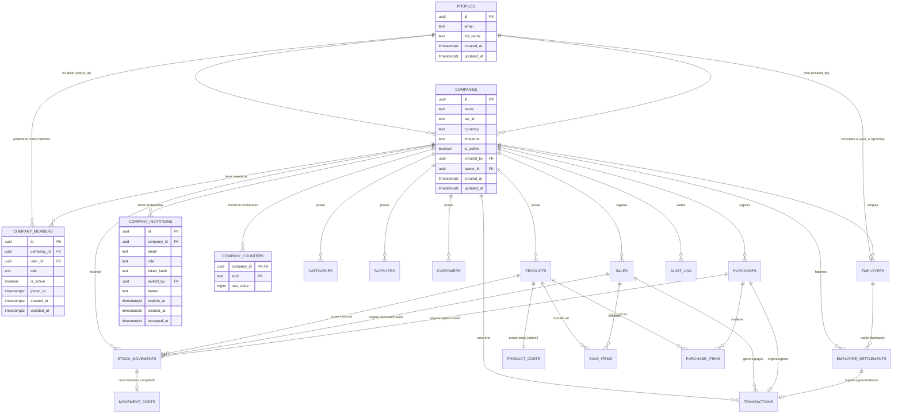

# 02. Modelo de Datos, Inmutabilidad e Índices
**Módulo:** Esquema Relacional Multiempresa (Pooled SaaS), Restricciones Compuestas, Triggers de Integridad e Índices  
**Versión:** 2.0  
**Fecha:** Octubre 2026  

---

## 1. Convenciones y Precisión de Tipos

- **Aislamiento Multiempresa por Fila:** Toda tabla del dominio de negocio incluye de forma obligatoria la columna `company_id UUID NOT NULL REFERENCES public.companies(id) ON DELETE RESTRICT`. La única tabla con `company_id` anulable es `audit_log` para registrar eventos de nivel plataforma o provisionamiento inicial.
- **Identidad Global Desacoplada:** `profiles` no contiene roles ni flags de activación de tenant (`role`, `is_active`, `employee_id` quedan completamente eliminados de `profiles`). La pertenencia y privilegios residen exclusivamente en `company_members`.
- **Integridad Referencial Compuesta Obligatoria:** Todas las claves foráneas inter-tablas del dominio deben ser compuestas `(company_id, foreign_id) REFERENCES tabla_padre(company_id, id) ON DELETE RESTRICT`. Esto imposibilita a nivel del motor relacional que una venta, movimiento o ítem de la Empresa A referencie un cliente, producto o proveedor de la Empresa B.
- **Regla de Claves Foráneas Opcionales (`MATCH SIMPLE`):** En relaciones opcionales (ej. `customer_id` en `sales`, o referencias en `stock_movements`), PostgreSQL aplica la semántica ANSI SQL `MATCH SIMPLE`: si al menos una columna de la FK es NULL (en este caso el ID foráneo), la restricción no se evalúa. Como `company_id` es `NOT NULL`, si se proporciona un ID foráneo, PostgreSQL valida forzosamente que `(company_id, foreign_id)` exista en la tabla referenciada, garantizando estricta pertenencia a la misma empresa.
- **Unicidad Compuesta de Clave Primaria Alternativa:** Toda tabla con ID sintético UUID dispone de una restricción `CONSTRAINT uq_tabla_company_id UNIQUE (company_id, id)` para servir como destino de las claves foráneas compuestas.
- **Cantidades Físicas:** `numeric(12, 2)` en todas las columnas cuantitativas (`quantity`, `current_stock`, `min_stock`), soportando unidades enteras y fraccionables (kilos, metros, litros) sin imprecisión de punto flotante.
- **Valores Monetarios:** `numeric(14, 2)` en precios, costos, subtotales, totales, transacciones y liquidaciones.
- **Identificadores:** `uuid` con generación por defecto `gen_random_uuid()`.
- **Numeración Transaccional Aislada:** Eliminación total de secuencias globales (`sale_number_seq`, `purchase_number_seq`). La correlatividad se gobierna por empresa en la tabla `company_counters` con bloqueo pesimista transaccional (`FOR UPDATE`).
- **Inmutabilidad Absoluta:** Tablas históricas (`stock_movements`, `sale_items`, `purchase_items`, `movement_costs`, `audit_log`) prohíben `UPDATE` y `DELETE` mediante permisos revocados y triggers.

---

## 2. Diagrama Entidad-Relación Multiempresa (Pooled)



---

## 3. Definición Detallada de Tablas y Columnas

### 3.1. `profiles` (Identidad Global Desacoplada)
```sql
CREATE TABLE public.profiles (
  id UUID PRIMARY KEY REFERENCES auth.users(id) ON DELETE RESTRICT,
  email TEXT NOT NULL,
  full_name TEXT NOT NULL,
  created_at TIMESTAMPTZ NOT NULL DEFAULT now(),
  updated_at TIMESTAMPTZ NOT NULL DEFAULT now()
);

CREATE OR REPLACE VIEW public.profiles_public AS
SELECT id, full_name
FROM public.profiles;

REVOKE ALL ON public.profiles_public FROM PUBLIC, anon;
GRANT SELECT ON public.profiles_public TO authenticated;
```

### 3.2. `companies` (Tenants / Empresas)
```sql
-- Función de validación de CUIT (Módulo 11 argentino)
CREATE OR REPLACE FUNCTION public.validate_cuit(p_cuit TEXT)
RETURNS BOOLEAN
LANGUAGE plpgsql
IMMUTABLE
AS $$
DECLARE
  v_clean_cuit TEXT;
  v_digits INT[];
  v_multipliers INT[] := ARRAY[5, 4, 3, 2, 7, 6, 5, 4, 3, 2];
  v_sum INT := 0;
  v_verifier INT;
  v_calc_verifier INT;
  i INT;
BEGIN
  IF p_cuit IS NULL THEN
    RETURN TRUE;
  END IF;
  
  -- Quitar guiones y espacios
  v_clean_cuit := regexp_replace(p_cuit, '[^0-9]', '', 'g');
  
  IF length(v_clean_cuit) != 11 THEN
    RETURN FALSE;
  END IF;
  
  FOR i IN 1..11 LOOP
    v_digits[i] := substring(v_clean_cuit FROM i FOR 1)::INT;
  END LOOP;
  
  FOR i IN 1..10 LOOP
    v_sum := v_sum + (v_digits[i] * v_multipliers[i]);
  END LOOP;
  
  v_calc_verifier := 11 - (v_sum % 11);
  IF v_calc_verifier = 11 THEN
    v_calc_verifier := 0;
  ELSIF v_calc_verifier = 10 THEN
    v_calc_verifier := 9;
  END IF;
  
  v_verifier := v_digits[11];
  RETURN v_calc_verifier = v_verifier;
END;
$$;

CREATE TABLE public.companies (
  id UUID PRIMARY KEY DEFAULT gen_random_uuid(),
  name TEXT NOT NULL,
  tax_id TEXT, -- CUIT opcional sin unicidad global obligatoria
  currency TEXT NOT NULL DEFAULT 'ARS',
  timezone TEXT NOT NULL DEFAULT 'America/Argentina/Buenos_Aires',
  is_active BOOLEAN NOT NULL DEFAULT true,
  created_by UUID NOT NULL REFERENCES public.profiles(id) ON DELETE RESTRICT,
  owner_id UUID NOT NULL REFERENCES public.profiles(id) ON DELETE RESTRICT,
  created_at TIMESTAMPTZ NOT NULL DEFAULT now(),
  updated_at TIMESTAMPTZ NOT NULL DEFAULT now(),
  CONSTRAINT check_cuit_format CHECK (tax_id IS NULL OR public.validate_cuit(tax_id))
);

-- Validación de zona horaria IANA contra pg_timezone_names
CREATE OR REPLACE FUNCTION public.validate_company_timezone()
RETURNS TRIGGER LANGUAGE plpgsql AS $$
BEGIN
  IF NOT EXISTS (SELECT 1 FROM pg_timezone_names WHERE name = NEW.timezone) THEN
    RAISE EXCEPTION 'Zona horaria no válida: %. Debe ser un nombre IANA (ej. America/Argentina/Buenos_Aires)', NEW.timezone;
  END IF;
  RETURN NEW;
END;
$$;

CREATE TRIGGER tr_validate_company_timezone
BEFORE INSERT OR UPDATE OF timezone ON public.companies
FOR EACH ROW EXECUTE FUNCTION public.validate_company_timezone();
```

### 3.3. `company_members` (Membresías y Roles por Empresa)
```sql
CREATE TABLE public.company_members (
  id UUID PRIMARY KEY DEFAULT gen_random_uuid(),
  company_id UUID NOT NULL REFERENCES public.companies(id) ON DELETE RESTRICT,
  user_id UUID NOT NULL REFERENCES public.profiles(id) ON DELETE RESTRICT,
  role TEXT NOT NULL CHECK (role IN ('master_admin', 'employee')),
  is_active BOOLEAN NOT NULL DEFAULT true,
  joined_at TIMESTAMPTZ NOT NULL DEFAULT now(),
  created_at TIMESTAMPTZ NOT NULL DEFAULT now(),
  updated_at TIMESTAMPTZ NOT NULL DEFAULT now(),
  CONSTRAINT uq_company_user UNIQUE (company_id, user_id),
  CONSTRAINT uq_company_members_composite UNIQUE (company_id, id)
);
```

### 3.4. `company_invitations` (Invitaciones por Token Hasheado)
```sql
CREATE TABLE public.company_invitations (
  id UUID PRIMARY KEY DEFAULT gen_random_uuid(),
  company_id UUID NOT NULL REFERENCES public.companies(id) ON DELETE RESTRICT,
  email TEXT NOT NULL,
  role TEXT NOT NULL CHECK (role IN ('master_admin', 'employee')),
  token_hash TEXT NOT NULL UNIQUE,
  invited_by UUID NOT NULL REFERENCES public.profiles(id) ON DELETE RESTRICT,
  status TEXT NOT NULL DEFAULT 'pending' CHECK (status IN ('pending', 'accepted', 'revoked', 'expired')),
  expires_at TIMESTAMPTZ NOT NULL DEFAULT (now() + interval '7 days'),
  created_at TIMESTAMPTZ NOT NULL DEFAULT now(),
  accepted_at TIMESTAMPTZ,
  CONSTRAINT uq_pending_invitation_per_email UNIQUE (company_id, email, status)
);
```

### 3.5. `company_counters` (Numeración Comercial Aislada)
```sql
CREATE TABLE public.company_counters (
  company_id UUID NOT NULL REFERENCES public.companies(id) ON DELETE RESTRICT,
  kind TEXT NOT NULL CHECK (kind IN ('sale', 'purchase')),
  last_value BIGINT NOT NULL DEFAULT 0 CHECK (last_value >= 0),
  PRIMARY KEY (company_id, kind)
);

-- Las secuencias globales sale_number_seq y purchase_number_seq quedan DEPRECADAS y ELIMINADAS.
-- Cada transacción de venta/compra ejecuta:
-- SELECT last_value FROM public.company_counters WHERE company_id = p_company_id AND kind = 'sale' FOR UPDATE;
-- y emite el correlativo formateado (ej. 'VTA-00000001').
```

### 3.6. `employees` (Personal y Nómina por Empresa)
```sql
CREATE TABLE public.employees (
  id UUID PRIMARY KEY DEFAULT gen_random_uuid(),
  company_id UUID NOT NULL REFERENCES public.companies(id) ON DELETE RESTRICT,
  employee_code TEXT NOT NULL,
  full_name TEXT NOT NULL,
  dni TEXT NOT NULL,
  phone TEXT,
  address TEXT,
  position TEXT NOT NULL,
  hire_date DATE NOT NULL,
  base_salary NUMERIC(14, 2) NOT NULL DEFAULT 0.00 CHECK (base_salary >= 0),
  is_active BOOLEAN NOT NULL DEFAULT true,
  user_id UUID REFERENCES public.profiles(id) ON DELETE RESTRICT,
  created_at TIMESTAMPTZ NOT NULL DEFAULT now(),
  updated_at TIMESTAMPTZ NOT NULL DEFAULT now(),
  CONSTRAINT uq_employees_company_id UNIQUE (company_id, id),
  CONSTRAINT uq_employees_company_dni UNIQUE (company_id, dni),
  CONSTRAINT uq_employees_company_code UNIQUE (company_id, employee_code)
);
```

### 3.7. `categories` y `suppliers` (Aislados por Tenant)
```sql
CREATE TABLE public.categories (
  id UUID PRIMARY KEY DEFAULT gen_random_uuid(),
  company_id UUID NOT NULL REFERENCES public.companies(id) ON DELETE RESTRICT,
  name TEXT NOT NULL,
  description TEXT,
  created_at TIMESTAMPTZ NOT NULL DEFAULT now(),
  CONSTRAINT uq_categories_company_id UNIQUE (company_id, id),
  CONSTRAINT uq_categories_company_name UNIQUE (company_id, name)
);

CREATE TABLE public.suppliers (
  id UUID PRIMARY KEY DEFAULT gen_random_uuid(),
  company_id UUID NOT NULL REFERENCES public.companies(id) ON DELETE RESTRICT,
  name TEXT NOT NULL,
  contact_name TEXT,
  email TEXT,
  phone TEXT,
  address TEXT,
  tax_id TEXT, -- CUIT
  is_active BOOLEAN NOT NULL DEFAULT true,
  created_at TIMESTAMPTZ NOT NULL DEFAULT now(),
  CONSTRAINT uq_suppliers_company_id UNIQUE (company_id, id)
);
```

### 3.8. `products` (Catálogo Comercial Multiempresa)
```sql
CREATE TABLE public.products (
  id UUID PRIMARY KEY DEFAULT gen_random_uuid(),
  company_id UUID NOT NULL REFERENCES public.companies(id) ON DELETE RESTRICT,
  sku TEXT NOT NULL,
  barcode TEXT,
  name TEXT NOT NULL,
  description TEXT,
  category_id UUID,
  supplier_id UUID,
  unit TEXT NOT NULL DEFAULT 'unidad',
  selling_price NUMERIC(14, 2) NOT NULL DEFAULT 0.00 CHECK (selling_price >= 0),
  min_stock NUMERIC(12, 2) NOT NULL DEFAULT 0.00 CHECK (min_stock >= 0),
  current_stock NUMERIC(12, 2) NOT NULL DEFAULT 0.00,
  is_active BOOLEAN NOT NULL DEFAULT true,
  created_at TIMESTAMPTZ NOT NULL DEFAULT now(),
  updated_at TIMESTAMPTZ NOT NULL DEFAULT now(),
  CONSTRAINT uq_products_company_id UNIQUE (company_id, id),
  CONSTRAINT uq_products_company_sku UNIQUE (company_id, sku),
  -- Foreign Keys Compuestas
  CONSTRAINT fk_products_category FOREIGN KEY (company_id, category_id)
    REFERENCES public.categories(company_id, id) ON DELETE RESTRICT,
  CONSTRAINT fk_products_supplier FOREIGN KEY (company_id, supplier_id)
    REFERENCES public.suppliers(company_id, id) ON DELETE RESTRICT
);

-- Unicidad de código de barras por empresa (solo cuando no es nulo)
CREATE UNIQUE INDEX uq_products_company_barcode ON public.products(company_id, barcode) WHERE barcode IS NOT NULL;
```

### 3.9. `product_costs` (Costos Confidenciales Multiempresa)
```sql
CREATE TABLE public.product_costs (
  company_id UUID NOT NULL REFERENCES public.companies(id) ON DELETE RESTRICT,
  product_id UUID NOT NULL,
  cost_price NUMERIC(14, 2) NOT NULL DEFAULT 0.00 CHECK (cost_price >= 0),
  updated_at TIMESTAMPTZ NOT NULL DEFAULT now(),
  updated_by UUID REFERENCES public.profiles(id) ON DELETE RESTRICT,
  PRIMARY KEY (company_id, product_id),
  CONSTRAINT fk_product_costs_product FOREIGN KEY (company_id, product_id)
    REFERENCES public.products(company_id, id) ON DELETE RESTRICT
);
```

### 3.10. `customers` (Clientes Multiempresa)
```sql
CREATE TABLE public.customers (
  id UUID PRIMARY KEY DEFAULT gen_random_uuid(),
  company_id UUID NOT NULL REFERENCES public.companies(id) ON DELETE RESTRICT,
  name TEXT NOT NULL,
  tax_id TEXT, -- CUIT o DNI
  email TEXT,
  phone TEXT,
  address TEXT,
  is_active BOOLEAN NOT NULL DEFAULT true,
  created_at TIMESTAMPTZ NOT NULL DEFAULT now(),
  CONSTRAINT uq_customers_company_id UNIQUE (company_id, id)
);
```

### 3.11. `sales` (Ventas Multiempresa)
```sql
CREATE TABLE public.sales (
  id UUID PRIMARY KEY DEFAULT gen_random_uuid(),
  company_id UUID NOT NULL REFERENCES public.companies(id) ON DELETE RESTRICT,
  sale_number TEXT NOT NULL, -- Generado desde company_counters: 'VTA-00000001'
  customer_id UUID,
  status TEXT NOT NULL DEFAULT 'completed' CHECK (status IN ('completed', 'cancelled')),
  subtotal NUMERIC(14, 2) NOT NULL CHECK (subtotal >= 0),
  discount NUMERIC(14, 2) NOT NULL DEFAULT 0.00 CHECK (discount >= 0),
  total_amount NUMERIC(14, 2) NOT NULL CHECK (total_amount >= 0),
  notes TEXT,
  cancelled_at TIMESTAMPTZ,
  cancelled_by UUID REFERENCES public.profiles(id) ON DELETE RESTRICT,
  cancel_reason TEXT,
  created_by UUID NOT NULL REFERENCES public.profiles(id) ON DELETE RESTRICT,
  created_at TIMESTAMPTZ NOT NULL DEFAULT now(),
  CONSTRAINT uq_sales_company_id UNIQUE (company_id, id),
  CONSTRAINT uq_sales_company_number UNIQUE (company_id, sale_number),
  CONSTRAINT fk_sales_customer FOREIGN KEY (company_id, customer_id)
    REFERENCES public.customers(company_id, id) ON DELETE RESTRICT
);
```

### 3.12. `sale_items` (Detalle de Venta — 100% Inmutable)
```sql
CREATE TABLE public.sale_items (
  id UUID PRIMARY KEY DEFAULT gen_random_uuid(),
  company_id UUID NOT NULL REFERENCES public.companies(id) ON DELETE RESTRICT,
  sale_id UUID NOT NULL,
  product_id UUID NOT NULL,
  quantity NUMERIC(12, 2) NOT NULL CHECK (quantity > 0),
  unit_price NUMERIC(14, 2) NOT NULL CHECK (unit_price >= 0),
  subtotal NUMERIC(14, 2) NOT NULL CHECK (subtotal >= 0),
  CONSTRAINT uq_sale_items_company_id UNIQUE (company_id, id),
  CONSTRAINT fk_sale_items_sale FOREIGN KEY (company_id, sale_id)
    REFERENCES public.sales(company_id, id) ON DELETE RESTRICT,
  CONSTRAINT fk_sale_items_product FOREIGN KEY (company_id, product_id)
    REFERENCES public.products(company_id, id) ON DELETE RESTRICT
);
```

### 3.13. `purchases` (Compras a Proveedores Multiempresa)
```sql
CREATE TABLE public.purchases (
  id UUID PRIMARY KEY DEFAULT gen_random_uuid(),
  company_id UUID NOT NULL REFERENCES public.companies(id) ON DELETE RESTRICT,
  purchase_number TEXT NOT NULL, -- Generado desde company_counters: 'COM-00000001'
  supplier_id UUID NOT NULL,
  status TEXT NOT NULL DEFAULT 'completed' CHECK (status IN ('completed', 'cancelled')),
  total_amount NUMERIC(14, 2) NOT NULL CHECK (total_amount >= 0),
  payment_method TEXT NOT NULL CHECK (payment_method IN ('cash', 'bank_transfer', 'credit_card', 'debit_card', 'check')),
  reference_doc TEXT,
  notes TEXT,
  cancelled_at TIMESTAMPTZ,
  cancelled_by UUID REFERENCES public.profiles(id) ON DELETE RESTRICT,
  cancel_reason TEXT,
  created_by UUID NOT NULL REFERENCES public.profiles(id) ON DELETE RESTRICT,
  created_at TIMESTAMPTZ NOT NULL DEFAULT now(),
  CONSTRAINT uq_purchases_company_id UNIQUE (company_id, id),
  CONSTRAINT uq_purchases_company_number UNIQUE (company_id, purchase_number),
  CONSTRAINT fk_purchases_supplier FOREIGN KEY (company_id, supplier_id)
    REFERENCES public.suppliers(company_id, id) ON DELETE RESTRICT
);
```

### 3.14. `purchase_items` (Detalle de Compras — 100% Inmutable)
```sql
CREATE TABLE public.purchase_items (
  id UUID PRIMARY KEY DEFAULT gen_random_uuid(),
  company_id UUID NOT NULL REFERENCES public.companies(id) ON DELETE RESTRICT,
  purchase_id UUID NOT NULL,
  product_id UUID NOT NULL,
  quantity NUMERIC(12, 2) NOT NULL CHECK (quantity > 0),
  unit_cost NUMERIC(14, 2) NOT NULL CHECK (unit_cost >= 0),
  subtotal NUMERIC(14, 2) NOT NULL CHECK (subtotal >= 0),
  CONSTRAINT uq_purchase_items_company_id UNIQUE (company_id, id),
  CONSTRAINT fk_purchase_items_purchase FOREIGN KEY (company_id, purchase_id)
    REFERENCES public.purchases(company_id, id) ON DELETE RESTRICT,
  CONSTRAINT fk_purchase_items_product FOREIGN KEY (company_id, product_id)
    REFERENCES public.products(company_id, id) ON DELETE RESTRICT
);
```

### 3.15. `stock_movements` (Historial Inmutable de Stock Multiempresa)
```sql
CREATE TABLE public.stock_movements (
  id UUID PRIMARY KEY DEFAULT gen_random_uuid(),
  company_id UUID NOT NULL REFERENCES public.companies(id) ON DELETE RESTRICT,
  product_id UUID NOT NULL,
  direction TEXT NOT NULL CHECK (direction IN ('increase', 'decrease')),
  reason TEXT NOT NULL,
  quantity NUMERIC(12, 2) NOT NULL CHECK (quantity > 0),
  reference_sale_id UUID,
  reference_purchase_id UUID,
  reference_doc TEXT,
  notes TEXT,
  created_by UUID NOT NULL REFERENCES public.profiles(id) ON DELETE RESTRICT,
  created_at TIMESTAMPTZ NOT NULL DEFAULT now(),
  CONSTRAINT uq_stock_movements_company_id UNIQUE (company_id, id),
  CONSTRAINT fk_stock_movements_product FOREIGN KEY (company_id, product_id)
    REFERENCES public.products(company_id, id) ON DELETE RESTRICT,
  CONSTRAINT fk_stock_movements_sale FOREIGN KEY (company_id, reference_sale_id)
    REFERENCES public.sales(company_id, id) ON DELETE RESTRICT,
  CONSTRAINT fk_stock_movements_purchase FOREIGN KEY (company_id, reference_purchase_id)
    REFERENCES public.purchases(company_id, id) ON DELETE RESTRICT,
  CONSTRAINT check_valid_direction_reason CHECK (
    (direction = 'increase' AND reason IN ('purchase', 'physical_count', 'cancellation', 'initial_load')) OR
    (direction = 'decrease' AND reason IN ('sale', 'loss_damage', 'internal_use', 'physical_count', 'purchase_cancellation'))
  )
);
```
> [!NOTE]
> En la secuencia de migraciones por tandas, `stock_movements` se crea en la Tanda 2.2 con `reference_sale_id` y `reference_purchase_id` como columnas `UUID NULL` sin FK, y las restricciones foráneas compuestas hacia `sales` y `purchases` se añaden mediante `ALTER TABLE` en la Tanda 2.3 al crearse el módulo comercial.

### 3.16. `movement_costs` (Costos Históricos Congelados — Solo `master_admin`)
```sql
CREATE TABLE public.movement_costs (
  company_id UUID NOT NULL REFERENCES public.companies(id) ON DELETE RESTRICT,
  movement_id UUID NOT NULL,
  unit_cost NUMERIC(14, 2) NOT NULL CHECK (unit_cost >= 0),
  total_cost NUMERIC(14, 2) NOT NULL CHECK (total_cost >= 0),
  PRIMARY KEY (company_id, movement_id),
  CONSTRAINT fk_movement_costs_movement FOREIGN KEY (company_id, movement_id)
    REFERENCES public.stock_movements(company_id, id) ON DELETE RESTRICT
);
```

### 3.17. `transactions` (Tesorería y Finanzas Multiempresa)
```sql
CREATE TABLE public.transactions (
  id UUID PRIMARY KEY DEFAULT gen_random_uuid(),
  company_id UUID NOT NULL REFERENCES public.companies(id) ON DELETE RESTRICT,
  type TEXT NOT NULL CHECK (type IN ('income', 'expense')),
  category TEXT NOT NULL CHECK (category IN ('sale', 'stock_purchase', 'operational_expense', 'salary_payment', 'cash_adjustment')),
  amount NUMERIC(14, 2) NOT NULL CHECK (amount >= 0),
  payment_method TEXT NOT NULL CHECK (payment_method IN ('cash', 'bank_transfer', 'credit_card', 'debit_card', 'check', 'courtesy')),
  status TEXT NOT NULL DEFAULT 'completed' CHECK (status IN ('completed', 'cancelled')),
  reference_sale_id UUID,
  reference_purchase_id UUID,
  reference_settlement_id UUID,
  description TEXT NOT NULL,
  transaction_date DATE NOT NULL DEFAULT CURRENT_DATE,
  created_by UUID NOT NULL REFERENCES public.profiles(id) ON DELETE RESTRICT,
  created_at TIMESTAMPTZ NOT NULL DEFAULT now(),
  CONSTRAINT uq_transactions_company_id UNIQUE (company_id, id),
  CONSTRAINT fk_transactions_sale FOREIGN KEY (company_id, reference_sale_id)
    REFERENCES public.sales(company_id, id) ON DELETE RESTRICT,
  CONSTRAINT fk_transactions_purchase FOREIGN KEY (company_id, reference_purchase_id)
    REFERENCES public.purchases(company_id, id) ON DELETE RESTRICT,
  CONSTRAINT fk_transactions_settlement FOREIGN KEY (company_id, reference_settlement_id)
    REFERENCES public.employee_settlements(company_id, id) ON DELETE RESTRICT
);
```

### 3.18. `employee_settlements` (Liquidaciones de Haberes Multiempresa)
```sql
CREATE TABLE public.employee_settlements (
  id UUID PRIMARY KEY DEFAULT gen_random_uuid(),
  company_id UUID NOT NULL REFERENCES public.companies(id) ON DELETE RESTRICT,
  employee_id UUID NOT NULL,
  period TEXT NOT NULL, -- 'AAAA-MM'
  amount NUMERIC(14, 2) NOT NULL CHECK (amount > 0),
  status TEXT NOT NULL DEFAULT 'draft' CHECK (status IN ('draft', 'confirmed', 'cancelled')),
  paid_date DATE,
  notes TEXT,
  cancelled_at TIMESTAMPTZ,
  cancelled_by UUID REFERENCES public.profiles(id) ON DELETE RESTRICT,
  cancel_reason TEXT,
  created_by UUID NOT NULL REFERENCES public.profiles(id) ON DELETE RESTRICT,
  created_at TIMESTAMPTZ NOT NULL DEFAULT now(),
  CONSTRAINT uq_employee_settlements_company_id UNIQUE (company_id, id),
  CONSTRAINT fk_settlements_employee FOREIGN KEY (company_id, employee_id)
    REFERENCES public.employees(company_id, id) ON DELETE RESTRICT
);
```

### 3.19. `audit_log` (Auditoría del Sistema Multiempresa — 100% Inmutable)
```sql
CREATE TABLE public.audit_log (
  id UUID PRIMARY KEY DEFAULT gen_random_uuid(),
  company_id UUID REFERENCES public.companies(id) ON DELETE RESTRICT, -- Nullable para auditoría de plataforma/creación
  table_name TEXT NOT NULL,
  record_id TEXT NOT NULL,
  action TEXT NOT NULL CHECK (action IN ('INSERT', 'UPDATE', 'DELETE')),
  old_data JSONB,
  new_data JSONB,
  performed_by UUID REFERENCES public.profiles(id) ON DELETE RESTRICT,
  actor_role TEXT, -- Rol ejercido en el momento del evento ('master_admin', 'employee', o NULL para sistema)
  created_at TIMESTAMPTZ NOT NULL DEFAULT now()
);
```

---

## 4. Protección y Sincronización de `current_stock`

### 4.1. Permisos Restringidos por Columna en `products`
```sql
REVOKE UPDATE ON public.products FROM authenticated, anon, public;

GRANT UPDATE (sku, barcode, name, description, category_id, supplier_id, unit, selling_price, min_stock, is_active)
ON public.products TO authenticated;
```

### 4.2. Trigger de Rechazo de Edición Directa de Stock
```sql
CREATE OR REPLACE FUNCTION public.reject_direct_stock_update()
RETURNS TRIGGER
LANGUAGE plpgsql
SECURITY DEFINER
SET search_path = ''
AS $$
BEGIN
  IF current_setting('stockapp.internal_stock_update', true) != 'true' THEN
    RAISE EXCEPTION 'La columna current_stock es administrada exclusivamente por stock_movements';
  END IF;
  RETURN NEW;
END;
$$;

CREATE TRIGGER tr_check_direct_stock_update
BEFORE UPDATE OF current_stock ON public.products
FOR EACH ROW EXECUTE FUNCTION public.reject_direct_stock_update();
```

### 4.3. Trigger de Stock en `stock_movements` (Sincronización Transaccional)
```sql
CREATE OR REPLACE FUNCTION public.sync_product_stock()
RETURNS TRIGGER
LANGUAGE plpgsql
SECURITY DEFINER
SET search_path = ''
AS $$
DECLARE
  v_current_stock NUMERIC;
BEGIN
  -- 1. Activar bandera de sesión transaccional local
  PERFORM set_config('stockapp.internal_stock_update', 'true', true);

  -- 2. Bloqueo pesimista de fila del producto (aislado por company_id)
  SELECT current_stock INTO v_current_stock
  FROM public.products
  WHERE id = NEW.product_id AND company_id = NEW.company_id
  FOR UPDATE;

  IF NOT FOUND THEN
    RAISE EXCEPTION 'Producto con ID % no encontrado en la empresa % para actualización de stock', NEW.product_id, NEW.company_id;
  END IF;

  -- 3. Cálculo de la nueva existencia
  IF NEW.direction = 'increase' THEN
    UPDATE public.products
    SET current_stock = current_stock + NEW.quantity, updated_at = now()
    WHERE id = NEW.product_id AND company_id = NEW.company_id;
  ELSIF NEW.direction = 'decrease' THEN
    UPDATE public.products
    SET current_stock = current_stock - NEW.quantity, updated_at = now()
    WHERE id = NEW.product_id AND company_id = NEW.company_id;
  END IF;

  -- 4. Regla de Stock Negativo:
  -- Si current_stock resulta < 0, la operación NO se aborta.
  -- Se permite el saldo negativo y el producto se marca en la UI con badge --danger de advertencia.
  -- La valuación de salida se congela al último costo de reposición conocido (product_costs.cost_price).

  -- 5. Restablecer bandera interna de sesión transaccional local
  PERFORM set_config('stockapp.internal_stock_update', 'false', true);

  RETURN NEW;
END;
$$;

CREATE TRIGGER tr_sync_stock_movements
AFTER INSERT ON public.stock_movements
FOR EACH ROW EXECUTE FUNCTION public.sync_product_stock();
```

---

## 5. Inmutabilidad y Triggers de Estado Multiempresa

### 5.1. Inmutabilidad Estricta
```sql
CREATE OR REPLACE FUNCTION public.prevent_immutable_modification()
RETURNS TRIGGER
LANGUAGE plpgsql
SECURITY DEFINER
SET search_path = ''
AS $$
BEGIN
  RAISE EXCEPTION 'Operación % prohibida en la tabla inmutable %', TG_OP, TG_TABLE_NAME;
END;
$$;

CREATE TRIGGER tr_immutable_stock_movements BEFORE UPDATE OR DELETE ON public.stock_movements FOR EACH ROW EXECUTE FUNCTION public.prevent_immutable_modification();
CREATE TRIGGER tr_immutable_sale_items BEFORE UPDATE OR DELETE ON public.sale_items FOR EACH ROW EXECUTE FUNCTION public.prevent_immutable_modification();
CREATE TRIGGER tr_immutable_purchase_items BEFORE UPDATE OR DELETE ON public.purchase_items FOR EACH ROW EXECUTE FUNCTION public.prevent_immutable_modification();
CREATE TRIGGER tr_immutable_movement_costs BEFORE UPDATE OR DELETE ON public.movement_costs FOR EACH ROW EXECUTE FUNCTION public.prevent_immutable_modification();
CREATE TRIGGER tr_immutable_audit_log BEFORE UPDATE OR DELETE ON public.audit_log FOR EACH ROW EXECUTE FUNCTION public.prevent_immutable_modification();
```

### 5.2. Anulación Controlada en `sales` y `purchases`
```sql
CREATE OR REPLACE FUNCTION public.check_sale_cancellation()
RETURNS TRIGGER
LANGUAGE plpgsql
SECURITY DEFINER
SET search_path = ''
AS $$
BEGIN
  IF TG_OP = 'DELETE' THEN
    RAISE EXCEPTION 'Prohibido eliminar ventas o compras';
  END IF;

  IF TG_OP = 'UPDATE' THEN
    IF current_setting('stockapp.allow_cancellation', true) != 'true' THEN
      RAISE EXCEPTION 'Comprobantes son inmutables; solo se pueden anular mediante RPC autorizada';
    END IF;

    IF OLD.status != 'completed' OR NEW.status != 'cancelled' THEN
      RAISE EXCEPTION 'Transición no permitida. Solo se admite completed -> cancelled';
    END IF;

    IF NEW.cancelled_at IS NULL OR NEW.cancelled_by IS NULL OR NEW.cancel_reason IS NULL THEN
      RAISE EXCEPTION 'Debe registrar cancelled_at, cancelled_by y cancel_reason';
    END IF;
  END IF;

  RETURN NEW;
END;
$$;

CREATE TRIGGER tr_sales_state BEFORE UPDATE OR DELETE ON public.sales FOR EACH ROW EXECUTE FUNCTION public.check_sale_cancellation();
CREATE TRIGGER tr_purchases_state BEFORE UPDATE OR DELETE ON public.purchases FOR EACH ROW EXECUTE FUNCTION public.check_sale_cancellation();
```

### 5.3. Trigger Automático de `product_costs`
```sql
CREATE OR REPLACE FUNCTION public.create_initial_product_cost()
RETURNS TRIGGER
LANGUAGE plpgsql
SECURITY DEFINER
SET search_path = ''
AS $$
BEGIN
  INSERT INTO public.product_costs (company_id, product_id, cost_price, updated_at, updated_by)
  VALUES (NEW.company_id, NEW.id, 0.00, now(), auth.uid());
  RETURN NEW;
END;
$$;

CREATE TRIGGER tr_create_initial_product_cost
AFTER INSERT ON public.products
FOR EACH ROW EXECUTE FUNCTION public.create_initial_product_cost();
```

### 5.4. Trigger Universal de Auditoría Multiempresa
```sql
CREATE OR REPLACE FUNCTION public.audit_trigger()
RETURNS TRIGGER
LANGUAGE plpgsql
SECURITY DEFINER
SET search_path = ''
AS $$
DECLARE
  v_pk_col TEXT := COALESCE(TG_ARGV[0], 'id');
  v_record_id TEXT;
  v_company_id UUID := NULL;
  v_old_data JSONB := NULL;
  v_new_data JSONB := NULL;
  v_actor_role TEXT := NULL;
BEGIN
  -- Omitir auditoría en products si solo cambiaron current_stock o updated_at
  IF TG_TABLE_NAME = 'products' AND TG_OP = 'UPDATE' THEN
    IF (to_jsonb(NEW) - 'current_stock' - 'updated_at') = (to_jsonb(OLD) - 'current_stock' - 'updated_at') THEN
      RETURN NEW;
    END IF;
  END IF;

  IF TG_OP = 'DELETE' THEN
    v_record_id := to_jsonb(OLD) ->> v_pk_col;
    v_old_data := to_jsonb(OLD);
    v_company_id := (to_jsonb(OLD) ->> 'company_id')::UUID;
  ELSIF TG_OP = 'INSERT' THEN
    v_record_id := to_jsonb(NEW) ->> v_pk_col;
    v_new_data := to_jsonb(NEW);
    v_company_id := (to_jsonb(NEW) ->> 'company_id')::UUID;
  ELSIF TG_OP = 'UPDATE' THEN
    v_record_id := to_jsonb(NEW) ->> v_pk_col;
    v_old_data := to_jsonb(OLD);
    v_new_data := to_jsonb(NEW);
    v_company_id := (to_jsonb(NEW) ->> 'company_id')::UUID;
  END IF;

  -- Resolver rol activo del actor si hay company_id
  IF v_company_id IS NOT NULL AND auth.uid() IS NOT NULL THEN
    SELECT role INTO v_actor_role
    FROM public.company_members
    WHERE company_id = v_company_id AND user_id = auth.uid() AND is_active = true;
  END IF;

  INSERT INTO public.audit_log (
    company_id,
    table_name,
    record_id,
    action,
    old_data,
    new_data,
    performed_by,
    actor_role,
    created_at
  ) VALUES (
    v_company_id,
    TG_TABLE_NAME,
    v_record_id,
    TG_OP,
    v_old_data,
    v_new_data,
    auth.uid(),
    v_actor_role,
    now()
  );

  RETURN COALESCE(NEW, OLD);
END;
$$;
```

---

## 6. Habilitación Universal de RLS y Revocación de Mutaciones

```sql
-- Habilitación explícita de RLS en todas las tablas
ALTER TABLE public.profiles ENABLE ROW LEVEL SECURITY;
ALTER TABLE public.companies ENABLE ROW LEVEL SECURITY;
ALTER TABLE public.company_members ENABLE ROW LEVEL SECURITY;
ALTER TABLE public.company_invitations ENABLE ROW LEVEL SECURITY;
ALTER TABLE public.company_counters ENABLE ROW LEVEL SECURITY;
ALTER TABLE public.employees ENABLE ROW LEVEL SECURITY;
ALTER TABLE public.categories ENABLE ROW LEVEL SECURITY;
ALTER TABLE public.suppliers ENABLE ROW LEVEL SECURITY;
ALTER TABLE public.products ENABLE ROW LEVEL SECURITY;
ALTER TABLE public.product_costs ENABLE ROW LEVEL SECURITY;
ALTER TABLE public.customers ENABLE ROW LEVEL SECURITY;
ALTER TABLE public.sales ENABLE ROW LEVEL SECURITY;
ALTER TABLE public.sale_items ENABLE ROW LEVEL SECURITY;
ALTER TABLE public.purchases ENABLE ROW LEVEL SECURITY;
ALTER TABLE public.purchase_items ENABLE ROW LEVEL SECURITY;
ALTER TABLE public.stock_movements ENABLE ROW LEVEL SECURITY;
ALTER TABLE public.movement_costs ENABLE ROW LEVEL SECURITY;
ALTER TABLE public.transactions ENABLE ROW LEVEL SECURITY;
ALTER TABLE public.employee_settlements ENABLE ROW LEVEL SECURITY;
ALTER TABLE public.audit_log ENABLE ROW LEVEL SECURITY;

-- Revocación de mutaciones directas en tablas administradas por RPCs transaccionales
REVOKE INSERT, UPDATE, DELETE ON public.companies FROM authenticated, anon, public;
REVOKE INSERT, UPDATE, DELETE ON public.company_members FROM authenticated, anon, public;
REVOKE INSERT, UPDATE, DELETE ON public.company_invitations FROM authenticated, anon, public;
REVOKE INSERT, UPDATE, DELETE ON public.company_counters FROM authenticated, anon, public;
REVOKE INSERT, UPDATE, DELETE ON public.stock_movements FROM authenticated, anon, public;
REVOKE INSERT, UPDATE, DELETE ON public.movement_costs FROM authenticated, anon, public;
REVOKE INSERT, UPDATE, DELETE ON public.sales FROM authenticated, anon, public;
REVOKE INSERT, UPDATE, DELETE ON public.sale_items FROM authenticated, anon, public;
REVOKE INSERT, UPDATE, DELETE ON public.purchases FROM authenticated, anon, public;
REVOKE INSERT, UPDATE, DELETE ON public.purchase_items FROM authenticated, anon, public;
REVOKE INSERT, UPDATE, DELETE ON public.transactions FROM authenticated, anon, public;
REVOKE INSERT, UPDATE, DELETE ON public.employee_settlements FROM authenticated, anon, public;
REVOKE INSERT, UPDATE, DELETE ON public.audit_log FROM authenticated, anon, public;
```

---

## 7. Lista Completa de Índices Multiempresa

```sql
-- 1. Núcleo Multiempresa y Membresías
CREATE INDEX idx_company_members_user_id ON public.company_members(user_id);
CREATE INDEX idx_company_members_company_active ON public.company_members(company_id, is_active);
CREATE INDEX idx_company_invitations_token ON public.company_invitations(token_hash);
CREATE INDEX idx_company_invitations_company_status ON public.company_invitations(company_id, status);

-- 2. Claves Foráneas Compuestas: Productos y Catálogo
CREATE INDEX idx_products_company_category ON public.products(company_id, category_id);
CREATE INDEX idx_products_company_supplier ON public.products(company_id, supplier_id);
CREATE INDEX idx_products_company_active ON public.products(company_id, is_active);
CREATE INDEX idx_product_costs_company_product ON public.product_costs(company_id, product_id);

-- 3. Claves Foráneas Compuestas: Ventas e Ítems
CREATE INDEX idx_sales_company_customer ON public.sales(company_id, customer_id);
CREATE INDEX idx_sales_company_created_by ON public.sales(company_id, created_by);
CREATE INDEX idx_sales_company_status ON public.sales(company_id, status);
CREATE INDEX idx_sale_items_company_sale ON public.sale_items(company_id, sale_id);
CREATE INDEX idx_sale_items_company_product ON public.sale_items(company_id, product_id);

-- 4. Claves Foráneas Compuestas: Compras e Ítems
CREATE INDEX idx_purchases_company_supplier ON public.purchases(company_id, supplier_id);
CREATE INDEX idx_purchases_company_created_by ON public.purchases(company_id, created_by);
CREATE INDEX idx_purchases_company_status ON public.purchases(company_id, status);
CREATE INDEX idx_purchase_items_company_purchase ON public.purchase_items(company_id, purchase_id);
CREATE INDEX idx_purchase_items_company_product ON public.purchase_items(company_id, product_id);

-- 5. Claves Foráneas Compuestas: Movimientos de Stock
CREATE INDEX idx_stock_movements_company_product ON public.stock_movements(company_id, product_id);
CREATE INDEX idx_stock_movements_company_sale ON public.stock_movements(company_id, reference_sale_id);
CREATE INDEX idx_stock_movements_company_purchase ON public.stock_movements(company_id, reference_purchase_id);
CREATE INDEX idx_movement_costs_company_movement ON public.movement_costs(company_id, movement_id);

-- 6. Claves Foráneas Compuestas: Transacciones Financieras
CREATE INDEX idx_transactions_company_sale ON public.transactions(company_id, reference_sale_id);
CREATE INDEX idx_transactions_company_purchase ON public.transactions(company_id, reference_purchase_id);
CREATE INDEX idx_transactions_company_settlement ON public.transactions(company_id, reference_settlement_id);

-- 7. Claves Foráneas Compuestas: Nómina y Liquidaciones
CREATE INDEX idx_employees_company_user ON public.employees(company_id, user_id);
CREATE INDEX idx_employees_company_active ON public.employees(company_id, is_active);
CREATE INDEX idx_employee_settlements_company_employee ON public.employee_settlements(company_id, employee_id);
CREATE INDEX idx_employee_settlements_company_status ON public.employee_settlements(company_id, status);

-- 8. Índices Compuestos para Paginación de Feed por Cursor (company_id, created_at DESC, id DESC)
CREATE INDEX idx_stock_movements_cursor ON public.stock_movements(company_id, created_at DESC, id DESC);
CREATE INDEX idx_transactions_cursor ON public.transactions(company_id, created_at DESC, id DESC);
CREATE INDEX idx_audit_log_cursor ON public.audit_log(company_id, created_at DESC, id DESC);
```
